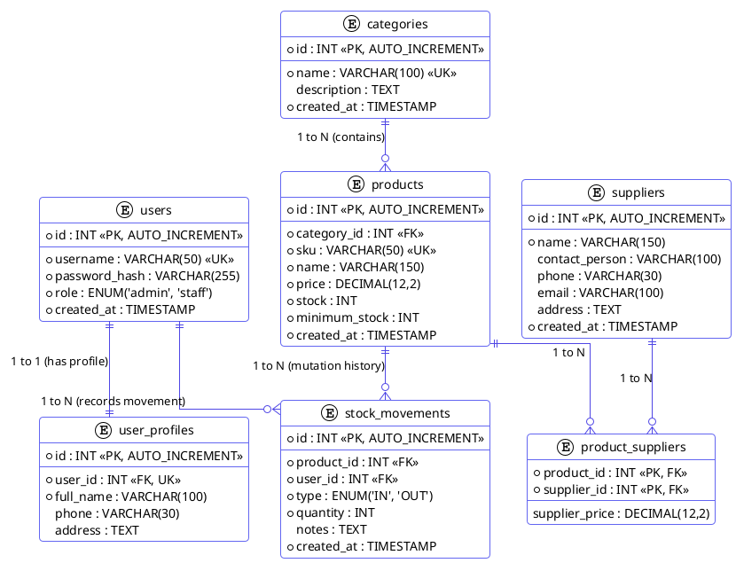
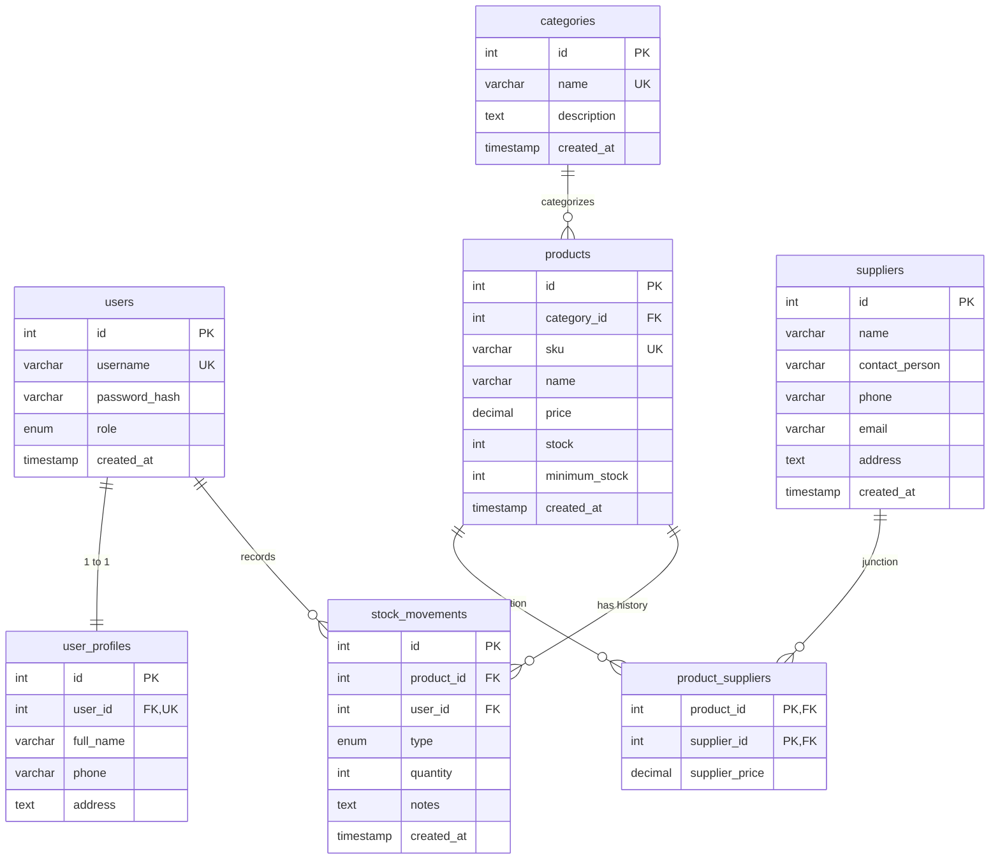

# Panduan Pembuatan ERD di Draw.io (InvenTrack IMS)

Dokumen ini berisi kode **PlantUML**, **Mermaid**, dan **SQL DDL** yang dapat langsung Anda masukkan (*import*) ke [draw.io (diagrams.net)](https://app.diagrams.net) untuk menghasilkan diagram relasi database (ERD) secara instan dan rapi.

---

## Cara Import ke Draw.io

1. Buka [https://app.diagrams.net](https://app.diagrams.net) (atau aplikasi Draw.io Desktop).
2. Buat dokumen baru (*Blank Diagram*).
3. Pada menu bar atas, klik:
   👉 **`Arrange`** $\rightarrow$ **`Insert`** $\rightarrow$ **`Advanced`**
   *(atau klik ikon tanda plus `+` di toolbar $\rightarrow$ `Advanced`)*.
4. Pilih salah satu format di bawah:
   - Pilih **PlantUML** untuk Kode 1 (Direkomendasikan - visual Crow's Foot paling detail).
   - Pilih **Mermaid** untuk Kode 2.
   - Pilih **SQL** untuk Kode 3.
5. Tempel (*paste*) kodenya, lalu klik tombol **Insert**.
6. Diagram ERD akan langsung ter-generate secara otomatis!

---

## 1. Kode PlantUML (Direkomendasikan)
*Gunakan menu: `+` $\rightarrow$ `Advanced` $\rightarrow$ `PlantUML`*



---

## 2. Kode Mermaid ERD
*Gunakan menu: `+` $\rightarrow$ `Advanced` $\rightarrow$ `Mermaid`*



---

## 3. SQL DDL (Import Otomatis Skema ke Draw.io)
*Gunakan menu: `+` $\rightarrow$ `Advanced` $\rightarrow$ `SQL`*

```sql
CREATE TABLE users (
    id INT PRIMARY KEY AUTO_INCREMENT,
    username VARCHAR(50) NOT NULL UNIQUE,
    password_hash VARCHAR(255) NOT NULL,
    role ENUM('admin', 'staff') NOT NULL DEFAULT 'staff',
    created_at TIMESTAMP DEFAULT CURRENT_TIMESTAMP
);

CREATE TABLE user_profiles (
    id INT PRIMARY KEY AUTO_INCREMENT,
    user_id INT NOT NULL UNIQUE,
    full_name VARCHAR(100) NOT NULL,
    phone VARCHAR(30) NULL,
    address TEXT NULL,
    FOREIGN KEY (user_id) REFERENCES users(id) ON UPDATE CASCADE ON DELETE CASCADE
);

CREATE TABLE categories (
    id INT PRIMARY KEY AUTO_INCREMENT,
    name VARCHAR(100) NOT NULL UNIQUE,
    description TEXT NULL,
    created_at TIMESTAMP DEFAULT CURRENT_TIMESTAMP
);

CREATE TABLE suppliers (
    id INT PRIMARY KEY AUTO_INCREMENT,
    name VARCHAR(150) NOT NULL,
    contact_person VARCHAR(100) NULL,
    phone VARCHAR(30) NULL,
    email VARCHAR(100) NULL,
    address TEXT NULL,
    created_at TIMESTAMP DEFAULT CURRENT_TIMESTAMP
);

CREATE TABLE products (
    id INT PRIMARY KEY AUTO_INCREMENT,
    category_id INT NOT NULL,
    sku VARCHAR(50) NOT NULL UNIQUE,
    name VARCHAR(150) NOT NULL,
    price DECIMAL(12,2) NOT NULL,
    stock INT NOT NULL DEFAULT 0,
    minimum_stock INT NOT NULL DEFAULT 5,
    created_at TIMESTAMP DEFAULT CURRENT_TIMESTAMP,
    FOREIGN KEY (category_id) REFERENCES categories(id) ON UPDATE CASCADE ON DELETE RESTRICT
);

CREATE TABLE product_suppliers (
    product_id INT NOT NULL,
    supplier_id INT NOT NULL,
    supplier_price DECIMAL(12,2) NULL,
    PRIMARY KEY (product_id, supplier_id),
    FOREIGN KEY (product_id) REFERENCES products(id) ON UPDATE CASCADE ON DELETE CASCADE,
    FOREIGN KEY (supplier_id) REFERENCES suppliers(id) ON UPDATE CASCADE ON DELETE RESTRICT
);

CREATE TABLE stock_movements (
    id INT PRIMARY KEY AUTO_INCREMENT,
    product_id INT NOT NULL,
    user_id INT NOT NULL,
    type ENUM('IN', 'OUT') NOT NULL,
    quantity INT NOT NULL,
    notes TEXT NULL,
    created_at TIMESTAMP DEFAULT CURRENT_TIMESTAMP,
    FOREIGN KEY (product_id) REFERENCES products(id) ON UPDATE CASCADE ON DELETE RESTRICT,
    FOREIGN KEY (user_id) REFERENCES users(id) ON UPDATE CASCADE ON DELETE RESTRICT
);
```
